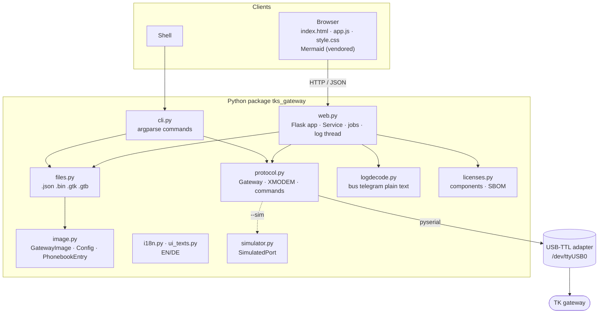
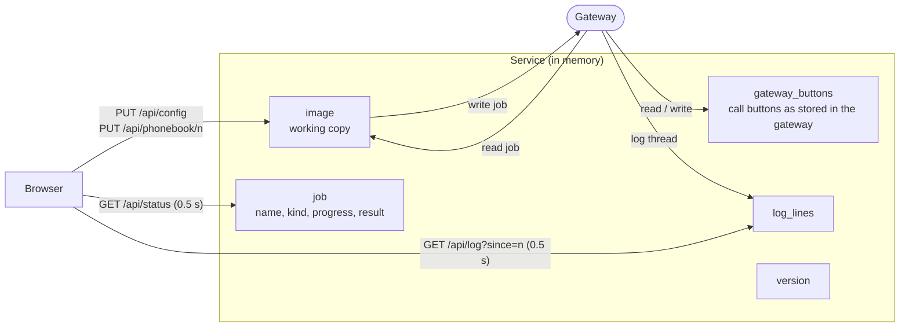
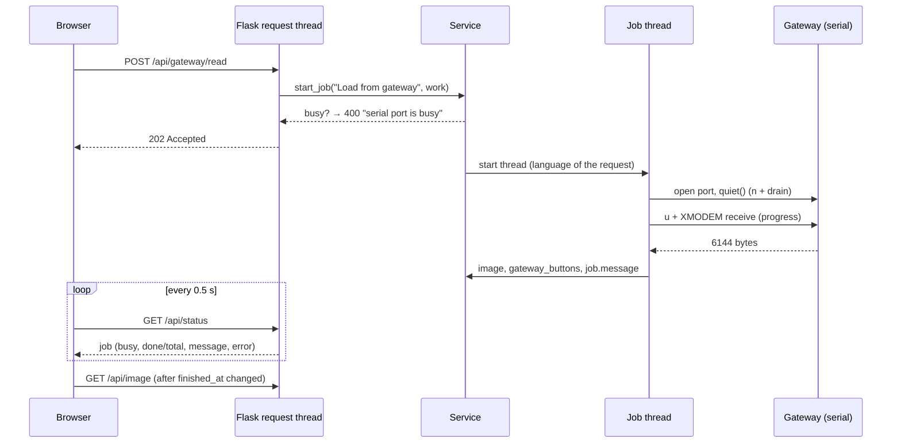
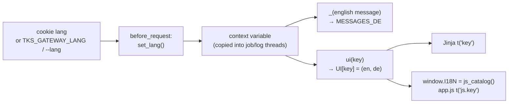

# Software architecture

How tks-gateway is built: modules, data flow, concurrency, the HTTP API, the
frontend, internationalisation, licenses/SBOM, deployment and tests. For the
device protocol see [PROTOCOL.md](PROTOCOL.md), for the device hardware [HARDWARE.md](HARDWARE.md), for the UI
[UI.md](UI.md), for usage the [user guide](USER_GUIDE.md) and the
[README](../README.md).

## Overview

tks-gateway re-implements the Windows commissioning software V1.01 of the Gira TK
gateway 1290 00 in Python. One package (`src/tks_gateway`) provides a command
line and a web UI on top of the same protocol and data model. It has two
runtime dependencies (pyserial, Flask) plus the optional WSGI server waitress.



## Modules

| Module | Responsibility |
|---|---|
| `protocol.py` | `Gateway`: serial commands (`i u d s p z t n`, bootloader `s`/`r`), XMODEM checksum send/receive (128-byte blocks, 48 blocks per image), `read_version`, `read_image`, `write_image`, `upload_firmware`, `upload_bustreiber`, `fetch_ruftaste`, `log_on/off`, `iter_log`, `quiet()`. `VersionInfo` parses the version text. Errors: `GatewayError`, `TransferTimeout`, `TransferError`. |
| `image.py` | Data model of the 6144-byte EEPROM image: `Config` (offsets 0x00–0xFF), `PhonebookEntry` (50 × 64 bytes from 0x100, names from 0x1000), `GatewayImage` (`from_bytes`, `to_bytes`, `with_config`, `with_phonebook`, `factory_defaults`, `validate`). Unknown bytes are preserved. |
| `files.py` | Conversion to/from dicts (API), `.json`, raw `.bin`, and the original formats `.gtk` (configuration report) and `.gtb` (phonebook grid). |
| `logdecode.py` | Plain text for log lines (`S:`/`E:`/`T:` + telegram codes), `telegram()` for code/fields, `tuerruf_adresse()` extracts the button code of a door call. |
| `web.py` | Flask app factory `create_app()`, `Service` (state), JSON API, background jobs, log thread, `main()` (waitress or Flask dev server). |
| `cli.py` | Command line (`ports`, `web`, `version`, `read`, `show`, `write`, `set`, `defaults`, `entry`, `call-button`, `bootloader-reset`, `firmware`, `log`, `sbom`, `licenses`) with German aliases. |
| `simulator.py` | `SimulatedPort`: an in-memory gateway with the firmware's line buffer, XMODEM, `z`, log mode and bootloader mode – used by `--sim` and the tests. |
| `i18n.py` | Language handling (context variable), server message catalogue EN → DE, `ui()` / `js_catalog()` for the UI texts. |
| `ui_texts.py` | All UI texts as `key: (english, german)` – template keys and `js.*` keys for the frontend. |
| `licenses.py` | Runtime discovery of third-party components and their licenses; CycloneDX SBOM. |
| `templates/` | `index.html` (whole single-page UI, keyed texts), `help_en.html` / `help_de.html` (help tab: operating guide for the tool). |
| `static/` | `app.js` (frontend logic), `style.css`, `vendor/` (Mermaid + its npm `package.json` and license). |

## Data flow and state

The server holds the state; the browser is a thin view on it.



* **Working copy** (`Service.image`): all form edits go here via the API and
  are validated by the model. Only jobs touch the gateway.
* **Partial save like the original:** a write job first reads the current
  image from the gateway, replaces only the configuration or the phonebook
  area, validates and writes the complete image. After the write the part that
  was not written keeps its unsaved edits in the working copy.
* **Unsaved call buttons:** `gateway_buttons` is the list of (button code,
  door station) per entry as last read from or written to the gateway (also
  updated after a successful `z`). `unsaved_buttons()` compares it with the
  working copy; `/api/status` returns the entry numbers, the UI shows the
  notice. Door station changes without a button code do not count.
* **No persistence:** the state lives in memory of one process. A restart
  starts with factory defaults until *Load from gateway*. For the same reason
  the container runs exactly one process (waitress with threads).

## Concurrency and serial access



* **One user of the port at a time.** `Service.busy()` is true while a job or
  the log runs; `start_job` and `start_log` refuse otherwise (under a lock).
  The port is opened per job and closed afterwards, so another program (or the
  container) can use the adapter in between.
* **Jobs** run in daemon threads; progress is reported through a callback into
  `Job.done/total`; `finished_at` lets the frontend detect completion. `kind`
  is a language-independent identifier (e.g. `version`) for frontend logic.
* **Log thread:** opens the port, sends `t`, iterates `iter_log()` until the
  stop event is set, then sends `n` and closes. "Test output" writes `i` into
  the open log connection. Lines are stored with their raw text; the plain
  text is decoded per request (in the language of the request). A version
  text glued to a log line (`…01.26 S: 90 …`) is split into two entries.
* **Stale log mode:** the gateway keeps its log flag in RAM. If the host goes
  away while logging, the gateway keeps sending log lines that would garble
  later answers. Every connection therefore starts with `Gateway.quiet()`
  (`n`, drain for 0.3 s); `read_version` and `fetch_ruftaste` additionally
  skip log lines. The web UI notes a recovered stale log mode in the log.
* **Safety rules in code:** firmware/bus driver transfers need an uploaded
  file; `s`/`p` are never sent otherwise (both erase immediately, see
  [PROTOCOL.md](PROTOCOL.md#full-analysis-of-the-ttl-interface-firmware-126)).
  Image writes always send a complete, validated image.

## HTTP API

JSON over HTTP, no authentication (bind to localhost or a trusted network).
Errors (`ValueError`, `GatewayError`) return `400 {"error": "<message>"}` in
the request language. Uploads are limited to 2 MiB.

| Method & path | Purpose | Response |
|---|---|---|
| `GET /` | single-page UI (language from cookie `lang`) | HTML |
| `GET /api/status` | job, `log_active`, `device`, `sim`, `version`, `loaded`, `unsaved_buttons` | JSON |
| `GET /api/ports` | detected serial ports and the selected one | JSON |
| `POST /api/settings` | `{"device": "/dev/ttyUSB0"}` – select port (not while busy) | JSON |
| `GET /api/image` | working copy: `konfiguration`, `telefonbuch[50]`, `loaded` | JSON |
| `PUT /api/config` | replace configuration (validated) | image |
| `POST /api/config/werkseinstellungen` | configuration to factory settings | image |
| `PUT /api/phonebook/<n>` | replace entry 1–50 (validated) | image |
| `DELETE /api/phonebook/<n>` | clear entry | image |
| `DELETE /api/phonebook` | clear all entries | image |
| `POST /api/gateway/version` | job: read version | 202 |
| `POST /api/gateway/read` | job: read image into working copy | 202 |
| `POST /api/gateway/write` | job: `{"part": "konfiguration" \| "telefonbuch" \| "alles"}` | 202 |
| `POST /api/gateway/ruftaste/<n>` | job: `z` for entry n (door station from the working copy) | 202 |
| `POST /api/gateway/bootloader-reset` | job: `r` + version | 202 |
| `POST /api/gateway/firmware` | job: multipart `datei`, `art=bustreiber` for the PIC | 202 |
| `POST /api/log/start` · `/stop` · `/ping` | logging on / off / test output | JSON |
| `GET /api/log?since=n` | log lines from index n, `next` index | JSON |
| `DELETE /api/log` | clear log | JSON |
| `GET /api/log/download` | log as text file | text |
| `GET /api/export/<json\|bin\|gtk\|gtb>` | export working copy | file |
| `POST /api/import` | multipart `datei` (.json .bin .gtk .gtb) into working copy | image |
| `GET /api/licenses` | third-party components with license texts | JSON |
| `GET /api/sbom` | CycloneDX 1.5 SBOM (download) | JSON |
| `POST /api/sim/dtmf` | simulator only: emulate `* 3 * 1\|2 #` for the PBX test | JSON |

Field names of the image JSON are the German names of the original software
(`konfiguration`, `telefonbuch`, `anschlussart`, `tuerstation`, …); they are
also used in the `.json` file format and kept for compatibility.

## Frontend

A single page without build step or framework: `index.html` (rendered by
Jinja with the texts of the current language), `app.js` (plain ES2020),
`style.css` (CSS custom properties, light/dark scheme).

* **Polling loop** (`tick`, every 0.5 s): `GET /api/status` (buttons enabled
  or disabled, progress, badge, unsaved notice) and `GET /api/log?since=n`.
  When a job finishes, the working copy is fetched again and re-rendered.
* **Rendering:** `render(image)` fills the configuration form, the phonebook
  table and the log's phonebook column; all user data is HTML-escaped.
* **Actions:** buttons carry `data-action`; one click handler maps them to API
  calls. `guarded()` wraps async handlers and shows errors in the status bar.
* **Dialogs and wizards** use the native `<dialog>` element; wizard state is
  kept in small objects (`wiz`, `tk`, `tt1`, `tt2`) and driven by the log
  stream (door calls `E: 11`, `T: DIAL`).
* **Lazy parts:** Mermaid (2.5 MB) is loaded only when the Help tab opens;
  the license list is fetched only when the Licenses tab opens.
* **Tooltips:** elements with `data-help` get an *i* button with a popover
  (hover and keyboard focus).

## Internationalisation



* English is the source language. Server messages are written in English and
  translated with `_()` (keyword placeholders, positional-only message
  argument); missing translations fall back to English.
* UI texts live in `ui_texts.py` as `(english, german)` pairs. Templates use
  `t('key')`, the frontend gets the `js.*` subset as `window.I18N`.
* Long help content is a separate template per language (`help_<lang>.html`).
* Log lines store the English message (or the raw line) and are rendered per
  request, so switching the language also changes existing log entries.
* Field names and the `.gtk`/`.gtb` labels stay German for file compatibility.

## Licenses and SBOM

`licenses.py` determines the components at runtime – nothing is maintained by
hand, so the list always matches the running installation:

1. **Python:** starting from the distribution `tks-gateway` (and `waitress` if
   installed), follow `Requires-Dist` recursively through installed
   distributions (extras are skipped). For each: name, version, summary,
   project URL, license files from the dist-info. License: `License-Expression`,
   otherwise detected from the license text (MIT, BSD-2/3, Apache-2.0,
   ZPL-2.1, ISC), otherwise the trove classifier or declared name (marked as
   not SPDX).
2. **JavaScript:** every `static/vendor/<name>.package.json` (the original npm
   metadata) describes a bundled file; license text from `<name>.LICENSE`,
   SHA-256 of the bundle, and the bundled npm dependencies with their declared
   version ranges.
3. **SBOM:** CycloneDX 1.5 JSON with `metadata.component` (tks-gateway), all
   components with purl, licenses, external references, hashes, and the
   dependency graph. Served at `/api/sbom`, written by `tks-gateway sbom`.

## Simulator

`SimulatedPort` implements the `Port` protocol (`read`, `write`,
`reset_input_buffer`, `close`) and behaves like firmware 1.26: line buffer
(lower case, characters below `'0'` dropped, first character evaluated on CR),
version text without CRLF followed by `PIC Release`, `S: 90`/`S: 05` log lines
while logging, XMODEM in both directions (image only committed after exactly
48 blocks), `z` with argument checks, bootloader mode with bare `s`/`r`. It is
used by `--sim` and by the tests; the web app adds simulated bus traffic while
logging.

## Deployment

| Way | Notes |
|---|---|
| `pip install -e .` + `tks-gateway web` | Flask dev server, or waitress if installed |
| Container (`Dockerfile`, `compose.yaml`) | `python:3.12-slim`, `pip install . waitress`, one process with 8 threads on port 5000; the adapter is passed in via its `/dev/serial/by-id/…` path as `/dev/ttyUSB0`; rootless Podman uses `group_add: keep-groups` and `label=disable` (SELinux). Rebuild with `podman compose up -d --build --force-recreate`. |

Configuration by environment: `TKS_GATEWAY_PORT` (default port), `TKS_GATEWAY_LANG`
(default language); compose variables `SERIAL_DEVICE`, `SERIAL_GROUP`,
`BIND_ADDRESS`, `HTTP_PORT` (see `.env.example`). The UI has no
authentication – keep `BIND_ADDRESS=127.0.0.1` unless the network is trusted.

## Tests

`pytest` runs `tests/test_tks_gateway.py` against the simulator: image
round-trips and validation, XMODEM, commands, file formats, CLI, web API
(jobs, partial save, unsaved call buttons, stale log mode, language cookie,
help and licenses tabs, SBOM). `tests/test_e2e_wizard.py` drives the learning
wizard in Chromium via Playwright (skipped if Playwright or Chromium are
missing).

## Repository layout

```
├── README.md            entry point, links to all documents
├── LICENSE              MIT
├── DISCLAIMER.md        reverse engineering, trademarks, no warranty
├── docs/
│   ├── USER_GUIDE.md    system background, procedures and diagrams
│   ├── UI.md            complete UI reference
│   ├── ARCHITECTURE.md  this document
│   ├── HARDWARE.md      block-level hardware of the gateway
│   ├── PROTOCOL.md      serial protocol, memory image, firmware findings
│   └── PROTOKOLL.md     German translation of PROTOCOL.md
├── src/tks_gateway/     package (see Modules)
├── tests/
├── Dockerfile · compose.yaml · .env.example
└── pyproject.toml
```
