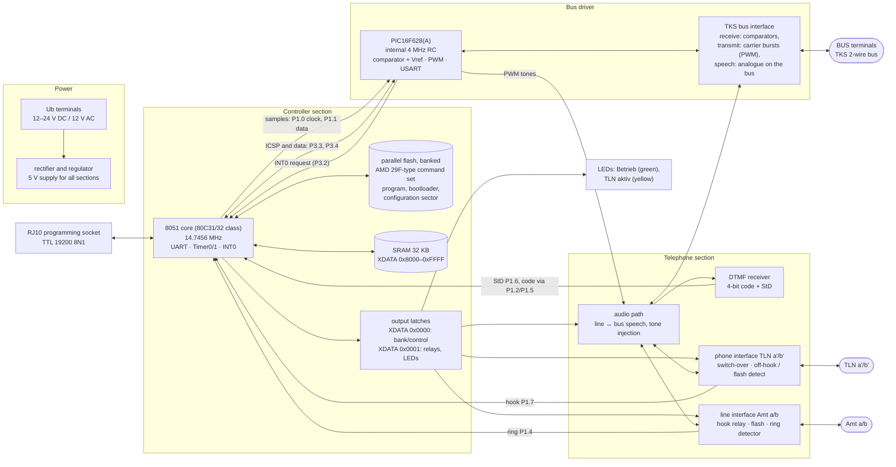
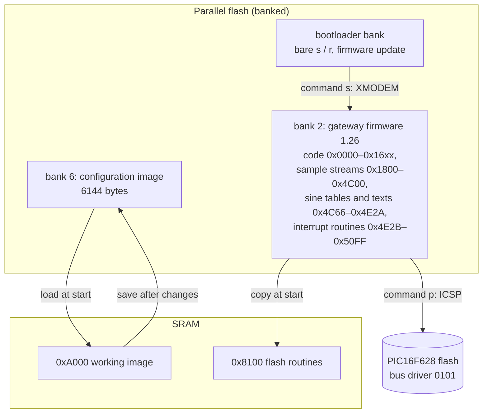

# Hardware overview (block level)

A block-level reconstruction of the Gira TK gateway 1290 00 hardware. There
is no public schematic; everything here is derived from the gateway firmware
1.26 (`tkg_126.tsk`, 8051), the bus driver firmware 0101 (`tkg_101.hex`, PIC),
the commissioning software V1.01, the device manual 12901310, the software
manual 12911310 and observations on a real device. The TKS bus side is
cross-checked against the independent reverse engineering of the
[GDoor project](https://gdoor-org.github.io/documentation/protocol.html) (bus protocol documentation, the
[audio issue](https://github.com/gdoor-org/gdoor/issues/20) and the
[GDoor firmware](https://github.com/gdoor-org/gdoor/tree/main/firmware/esp32/gdoor/src)). Exact part numbers, analogue circuitry and the
PCB layout are **not** known.

Related documents: [Protocol and firmware findings](PROTOCOL.md) ·
[User guide](USER_GUIDE.md) · [Software architecture](ARCHITECTURE.md) ·
[README](../README.md)

**Confidence** used in the tables:

| Mark | Meaning |
|---|---|
| ✅ confirmed | stated in a manual, measured on the device, or unambiguous in the firmware (register values, instruction sequences) |
| 🔶 derived | follows from how the firmware uses a pin or address, but the actual circuit is not visible |
| ❔ open | plausible assumption or not yet clarified |

## Block diagram



## External interfaces

| Interface | Function | Source |
|---|---|---|
| `Ub` (2 terminals) | 12–24 V DC or 12 V AC (TKS control unit, TKS power supply 24 V DC or bell transformer) | ✅ manual p. 9, p. 51 |
| `Amt a/b` | analogue line or analogue PBX extension, DTMF dialling only | ✅ manual p. 9, p. 51 |
| `TLN a'/b'` | analogue DTMF phone (direct line operation, programming by phone) | ✅ manual p. 9 |
| `BUS` (2 terminals) | 2-wire bus of the Gira door communication system | ✅ manual p. 9 |
| RJ10 programming socket | UART of the 8051, TTL level, 19200 8N1, pin 2 supplies +5 V to the cable | ✅ firmware (`TMOD=21h`, `TH1=FCh`, `PCON.7=1`), ✅ forum/measurement, see [pinout](USER_GUIDE.md#2-programming-plug-rj10--pinout) |
| LED "Betrieb" (green) | on = normal operation, flashing = TKS programming mode | ✅ manual p. 8 |
| LED "TLN aktiv" (yellow) | call via the phone at TLN | ✅ manual p. 8 |
| Housing | DIN rail device, 6 modules, IP 20, −10 … +60 °C | ✅ manual p. 8, p. 51 |

## Controller section

### Microcontroller

| Property | Value | Source |
|---|---|---|
| Core | 8051 instruction set, only standard 8051 SFRs used (no Timer 2, no extended SFRs) → 80C31/80C32 class with external program memory | ✅ firmware |
| Clock | 14.7456 MHz crystal: Timer1 auto-reload `FCh` with SMOD gives exactly 19200 baud; Timer0 reload `E800h` gives exactly 5 ms | ✅ firmware |
| Timers | Timer0 mode 1, 5 ms tick (×200 = 1 s timers); Timer1 mode 2 baud rate generator | ✅ firmware (`TMOD=21h`) |
| UART | mode 1, 8N1, receive enabled (`SCON=5Ch`) → programming socket | ✅ firmware |
| Interrupts | `IE=93h`: EA, serial, Timer0, INT0; `IP=01h`: INT0 high priority; `TCON=51h`: INT0 edge-triggered | ✅ firmware |
| Stack | internal RAM, `SP=5Fh` | ✅ firmware |

### Memory map

```
Code space (MOVC)                    XDATA (MOVX)
0x0000 ┌─────────────────────┐       0x0000 ┌─────────────────────┐ write, P1.3 = 0
       │ flash, current bank │              │ latch 0: bank/ctrl  │
       │ (bank 2 = firmware) │       0x0001 │ latch 1: outputs    │
       │                     │              │ (relays, LEDs)      │
       │                     │              ├─────────────────────┤ write, P1.3 = 1
       │                     │              │ flash write path    │
       │                     │              │ (JEDEC 5555/2AAA)   │
0x7FFF │                     │       0x7FFF ├─────────────────────┤
       │                     │       0x8000 │ SRAM                │
       │                     │              │ 8000 UART byte      │
       │                     │              │ 8100 flash routines │
       │                     │              │ 8400 HEX buffer     │
       │                     │              │ 8C00 line buffer    │
       │                     │              │ A000 image (6144 B) │
       │                     │              │ C000 receive buffer │
0xFFFF └─────────────────────┘       0xFFFF └─────────────────────┘
```

| Block | Details | Source |
|---|---|---|
| SRAM | external RAM from `0x8000`; used up to `0xD7FF` (32 KB part likely). At reset the firmware tests `0x8000–0x80FF` with a `55h/AAh` pattern and, on failure, flashes bit 3 of latch 1 forever (LED). | ✅ firmware (reset code at `0x0048`) |
| Flash | parallel 5 V flash in code space. Erase and program with the JEDEC sequences `AA/55` at `5555h/2AAAh` (sector erase `80h … 30h`, byte program `A0h`), completion via DQ7 data polling with DQ5 timeout – the AMD 29F command set. | ✅ firmware (routines at `0x12AD`, run from RAM `0x8100`) |
| Flash banks | bits 1–2 of latch 0 select the bank: bank 2 = running firmware (default value `02h`), bank 6 = configuration/phonebook. The bootloader (bare `s`/`r`) lives in another bank and is not part of the `.tsk`. With four 32 KB banks the part would be ≥ 128 KB. | ✅ bank values from firmware, 🔶 size |
| Non-volatile configuration | the 6144-byte image is stored in a **flash sector** (bank 6), copied to SRAM `0xA000` at start and written back sector-wise after changes. The manuals and the software call this "EEPROM"; there is no separate EEPROM chip in the firmware's view. | ✅ firmware (`0x1253…0x12AC` call the RAM flash routines with bank 6) |
| Write path select | **P1.3** gates `MOVX` writes in the lower 32 KB: P1.3 = 0 → I/O latches, P1.3 = 1 → flash write enable. The flash routines raise P1.3 only around command and data cycles and switch the bank back to 2 afterwards. | ✅ firmware |
| Latch 0 (`0x0000`) | write-only: flash bank (bits 1–2) and further control bits used during PIC programming (values `00h/02h/06h/0Ah` seen) | ✅ addresses/values, 🔶 bit meaning beyond the bank bits |
| Latch 1 (`0x0001`) | write-only output port, refreshed every 5 ms from internal RAM `21h` (idle value `41h`): relays, LEDs, switches of the telephone section. Bits are set, cleared and toggled in cadences (e.g. bit 1) – consistent with hook relay, TLN switching, ring generation and LEDs. | ✅ refresh and values, ❔ individual bit assignment |

### Port pins of the 8051

| Pin | Direction | Use | Source |
|---|---|---|---|
| P1.0 | out | clock of the sample link to the PIC | ✅ firmware (unrolled shift loops) |
| P1.1 | out | data of the sample link (MSB first) | ✅ firmware |
| P1.2 | out | shift clock for reading the DTMF code | ✅ firmware |
| P1.3 | out | write path select latches / flash | ✅ firmware |
| P1.4 | in | ring detector (Amt): each active level retriggers a 6 s "ringing" timer in the 50 ms raster | 🔶 firmware timing |
| P1.5 | in | serial data of the DTMF code (4 bits, LSB first) | ✅ firmware |
| P1.6 | in | DTMF "StD" (valid tone); rising edge starts reading the code; code `0Ah` → digit `0` (standard DTMF receiver coding) | ✅ firmware |
| P1.7 | in | debounced loop state with timing evaluation – most likely off-hook and flash detection of the phone at TLN (flash 80–250 ms is accepted per manual) | 🔶 firmware + manual p. 7 |
| P3.0 / P3.1 | in / out | UART RxD / TxD → RJ10 | ✅ |
| P3.2 (INT0) | in | request/clock from the PIC: each edge triggers the high-priority ISR that moves the next sample or bit | ✅ firmware |
| P3.3 | out | clock of the bit-serial PIC link (ICSP PGC during programming) | ✅ firmware |
| P3.4 | in/out | data of the bit-serial PIC link (ICSP PGD during programming) | ✅ firmware |
| P2 / P0 | bus | address/data bus to SRAM, flash and latches (P2 also as page register for `MOVX @Ri`) | ✅ firmware |

## TKS bus (physical layer)

Known from the GDoor project and consistent with the bus driver firmware:

| Property | Value | Source |
|---|---|---|
| Wiring | 2 wires, single-ended: one wire carries supply and signals, the other is ground | GDoor [protocol](https://gdoor-org.github.io/documentation/protocol.html) |
| Supply | ≈ 26 V DC, fed by the TKS control unit | GDoor |
| Digital signalling | bursts of a ≈ ±2 V sine carrier superimposed on the DC; the **length** of a burst encodes the bit: start bit ≈ 60 carrier periods, "1" ≈ 12, "0" ≈ 32, separated by fixed pauses without carrier | GDoor (measurement); ✅ identical counts in the bus driver, see below |
| Byte format | LSB first, 9th bit = odd parity; the last byte of a frame is the 8-bit sum of all previous bytes | GDoor; ✅ LSB-first shifting and a parity accumulator in the bus driver |
| Frame | `length/flags`, `status`, **action**, source address (3 bytes), parameter (2 bytes), device type, optional destination address (3 bytes), checksum | GDoor |
| Device type of the TK gateway | `0xA5` ("TKS TK Gateway") | GDoor; ❔ not found as a constant in the 8051 firmware – presumably added by the bus driver or the frame header |
| Speech | plain **analogue line-level audio** directly on the bus wires, present only between an "audio request" (`0x21`) and "end" (`0x20`) telegram; recorded successfully with a USB sound card behind a bridge rectifier | GDoor [issue 20](https://github.com/gdoor-org/gdoor/issues/20) |
| Video | FM at ≈ 11 MHz (video door stations only; the TK gateway does not handle video) | GDoor |

GDoor's own adapter transmits with a 60 kHz timer and 66 / 16 / 37 carrier
pulses for start / "1" / "0" and 30 pulses pause, and receives with a
comparator against an adjustable threshold of 1.3–1.65 V – the same receive
principle as the PIC's comparators with internal reference.

## Bus driver (PIC)

The "bus driver" (`tkg_101.hex`, version 0101) is a PIC16 midrange
microcontroller that the 8051 programs in-circuit.

| Property | Value | Source |
|---|---|---|
| Type | 2 K words program memory, data EEPROM, USART, CCP1, Timer1/2, comparators with voltage reference → **PIC16F628 / PIC16F628A** | ✅ register usage and memory size of the HEX file, 🔶 exact type |
| ID locations | `0, 1, 0, 1` → reported as "PIC Release 0101" | ✅ HEX file |
| Configuration word | `3FF4h`: internal RC oscillator (4 MHz) with RA6/RA7 as I/O, watchdog on, power-up timer on, MCLR enabled, brown-out reset on, **low-voltage programming on**, no code protection | ✅ HEX file |
| Comparators | `CMCON=26h`: two comparators with common reference and outputs; `VRCON=C7h`: internal reference on, output on RA2, ≈ 0.47 × VDD (≈ 2.3 V at 5 V) → carrier detector for the bus signal (same principle as GDoor's receive comparator) | ✅ register values, 🔶 purpose (consistent with GDoor) |
| Carrier generation | CCP1 PWM with `PR2=13h`, Timer2 prescaler 1:1, `CCPR1L=0Ah` → 20 µs period, 50 % duty, i.e. **50 kHz** square wave at the nominal 4 MHz internal oscillator on RB3, presumably filtered to the sine carrier. GDoor states ≈ 60 kHz – see open points. | ✅ register values, 🔶 purpose |
| Bit timing (transmit) | Timer2 postscaler 1:4 counts carrier periods: start bit `W=0Eh` → 15 × 4 = **60** periods, "1" `W=02h` → 3 × 4 = **12**, "0" `W=07h` → 8 × 4 = **32**; before each burst a pause of 5 × 4 = 20 periods without carrier | ✅ firmware; matches GDoor's measured 60 / 12 / 32 exactly |
| Byte format | bits are shifted out with `RRF` (LSB first); each "1" toggles bit 4 of a status register (`XORWF 0x71`) → parity bit | ✅ firmware, consistent with GDoor |
| Second Timer2 setting | `PR2=8Ch` (141 µs) with the PWM off – time base for receiving/pauses or audio PWM | ✅ register value, ❔ purpose |
| RAM address slots | four 3-byte slots at `A5h/A8h/ABh/AEh` (bank 1) are filled from the received source address – bus addresses remembered by the driver | ✅ firmware, ❔ meaning of the slots |
| USART | **synchronous slave** (`SYNC=1`, `CSRC=0`), continuous receive → receives the sample stream from the 8051 (clock P1.0, data P1.1) | ✅ register values, 🔶 wiring |
| Port directions | `TRISA=03h` (RA0/RA1 comparator inputs), `TRISB=D6h` (RB1/RB2 USART, RB4 PGM, RB6/RB7 PGC/PGD inputs; RB3 = CCP1 output) | ✅ HEX file |
| Programming by the gateway | the 8051 implements the PIC16 ICSP protocol in its INT0 ISR: 6-bit commands `01/07` (bulk erase setup), `02` (load data), `06` (increment address), `08` (begin programming), 14-bit data words with start/stop bit; P3.3 = PGC, P3.4 = PGD. The `p` command erases the PIC before receiving data. | ✅ firmware, see [PROTOCOL.md](PROTOCOL.md#full-analysis-of-the-ttl-interface-firmware-126) |

The bus driver handles the physical TKS bus: carrier generation and
detection, bit timing, parity, receiving and sending telegrams (e.g. `11`
door call, `31` open door, `90` version query) and, presumably, the PWM
output of tones. Telegrams reach the 8051 as 9-byte records beginning with
the action code (visible in the log as `S:`/`E:` lines); the frame header
and checksum of the bus frame do not appear there, so the bus driver adds and
removes them (🔶).

## Tone generation

| Finding | Source |
|---|---|
| The firmware contains sine tables centred on `0800h` (amplitude ≈ ±200h): `0x4C66` with 144 samples per period, `0x4D86` with 16 samples per period | ✅ firmware |
| About 13 KB (`0x1800–0x4C00`) are precomputed sample streams in the same format (values `06xx–09xx`), terminated by `0000h` | ✅ firmware |
| On each INT0 request from the PIC the ISR shifts the next sample (2 bytes) out on P1.0/P1.1 into the PIC's USART; the PIC outputs it via PWM | ✅ firmware, 🔶 PIC side |
| Use: command tone, programming-mode signal, acknowledgement tones (steady / pulsing), busy tone towards the door, and DTMF tones for dialling out (the device dials DTMF only, no pulse dialling) | ✅ tones listed in manual p. 13, p. 15, p. 51; 🔶 assignment to the streams |

## Telephone section

| Function | Details | Source |
|---|---|---|
| Line seizure / hook | relay on `Amt a/b`, controlled via latch 1; flash generation 200 ms after R (manual) and `F`/`f` dial characters 100/80 ms | ✅ manual p. 6, p. 13; 🔶 relay via latch |
| Ring detection (Amt) | input P1.4 with 6 s hold time; the gateway answers on the 3rd–4th ring (observed 12–20 s) | 🔶 firmware, ✅ observation |
| No hang-up detection on Amt | no loop-current or polarity input for the line was found; consistent with the 60 s command mode timeout and the busy tone on repeated calls | 🔶 firmware |
| DTMF receiver | separate receiver with 4-bit code and StD (MT8870/HT9170 family coding), read serially – presumably via a shift register | ✅ firmware, ❔ part |
| TLN interface | the phone at TLN is normally connected through to `Amt` (CLIP, dial tone and normal calls work, manual p. 6, p. 15) and is switched to the gateway for door calls and programming; off-hook/flash detection via P1.7; in direct line mode the gateway rings this phone (ring generation via the latch outputs) | ✅ manual, 🔶 circuit |
| Audio path | speech between line/TLN and bus – on the bus it is plain analogue audio superimposed on the 26 V (GDoor), so the gateway needs an analogue coupling with a hybrid/separation of the two directions; tone injection from the PIC; DTMF receiver input; switching via the gateway's own telegrams `A0`/`A1` (audio input TLN / transmitter to bus) | ✅ GDoor + telegram list, 🔶 circuit |

## Firmware structure on the hardware



## Open points

* Exact part numbers (8051 derivative, flash size, DTMF receiver, latches,
  relays, line transformer) – only a look at the PCB can clarify them.
* Bit assignment of the output latches (`0x0000` beyond the bank bits,
  `0x0001` per relay/LED).
* Wiring between PIC and 8051 beyond the lines named above (which PIC pin
  drives INT0, how received telegrams reach the 8051).
* Content and position of the bootloader bank (only readable from the flash
  chip).
* Carrier frequency: the PIC configuration gives 50 kHz at the nominal 4 MHz
  internal oscillator, GDoor states ≈ 60 kHz (measured on other devices; its
  own adapter sends 60 kHz). The bit lengths in carrier periods agree, so the
  receivers evidently tolerate the difference – or the gateway's oscillator
  runs faster than nominal. A scope measurement on the gateway would settle it.
* Where the frame header (`length/flags`, `status`), the device type `0xA5`
  and the checksum are added – in the bus driver (most likely) or elsewhere.
* Exact analogue coupling of the bus (carrier filter, audio coupling, the
  diode/bridge arrangement GDoor uses on its side).
