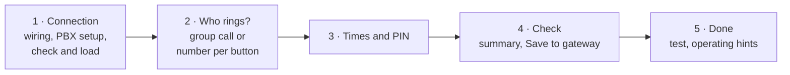
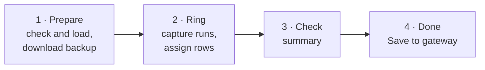

# UI reference

Complete description of the web UI: layout, every tab, every dialog and
wizard, and what each button does on the gateway. Background on the TKS and
the procedures is in the [user guide](USER_GUIDE.md); how the UI is built is in
the [software architecture](ARCHITECTURE.md).

Start the UI with `tks-gateway --port /dev/ttyUSB0 web` (or `--sim` without
hardware, or the container – see the [README](../README.md#web-ui)) and open
<http://127.0.0.1:5000/>.

## Contents

* [Basics](#basics) – layout, working copy, jobs, language, notices
* [Header](#header)
* Tabs: [Configuration](#tab-configuration) · [Phonebook](#tab-phonebook) ·
  [Log](#tab-log) · [Firmware](#tab-firmware) · [Phone codes](#tab-phone-codes) ·
  [Help](#tab-help) · [Licenses](#tab-licenses)
* Dialogs: [Phonebook entry](#dialog-phonebook-entry) ·
  [Assign call button](#dialog-assign-call-button) ·
  [Assign door call](#dialog-assign-door-call)
* Wizards: [Connect to PBX](#wizard-connect-to-pbx) ·
  [Test PBX](#wizard-test-pbx) · [Learn call buttons](#wizard-learn-call-buttons)
* [Status bar](#status-bar) · [Keyboard and links](#keyboard-and-links)

## Basics

```
┌────────────────────────────────────────────────────────────────────────────┐
│ Gira TK-Gateway 1290 00    Serial port [▾] ↻  [Test connection] (badge) EN|DE │  header
├────────────────────────────────────────────────────────────────────────────┤
│ Configuration  Phonebook  Log  Firmware  Phone codes  Help  Licenses       │  tabs
├────────────────────────────────────────────────────────────────────────────┤
│                                                                            │
│                         content of the active tab                          │
│                                                                            │
├────────────────────────────────────────────────────────────────────────────┤
│ [■■■■■■□□□□] Load from gateway 62 %                                        │  status bar
└────────────────────────────────────────────────────────────────────────────┘
```

**Working copy.** All tabs edit one working copy of the gateway image, held by
the server (not the browser). Nothing reaches the gateway until a
*Save to gateway* button is used. A hint at the top of the configuration tab
says whether the working copy was loaded from the gateway or still contains
default values ("first *Load from gateway* so nothing is overwritten").

**Device jobs.** Everything that talks to the gateway (read, write, version,
firmware, call button) runs as a background job on the server. Only one job or
the log can use the serial port at a time; while one runs, all buttons that
need the port (marked *device* below) are disabled. Progress and the result
appear in the [status bar](#status-bar).

**Language.** English by default; the `EN | DE` switch in the header changes
the language (stored in the `lang` cookie for one year) and reloads the page.
Server messages, log plain text, tooltips and help follow the language.

**Tooltips.** An *i* symbol after a field or column header shows an
explanation on hover or focus (e.g. what the ring times mean).

<a id="unsaved-call-buttons"></a>
**Unsaved call buttons.** Call buttons assigned passively (capture, log,
wizard) only change the working copy. An orange notice in the Log tab (and in
the Phonebook tab while something is pending) says how many assignments are
not yet in the gateway, e.g. "1 call button assignment not yet saved in the
gateway (entry 4)", with a *Save phonebook to gateway* button. While logging
runs it adds "Stop logging first" (the port is busy). The server tracks this
by comparing the working copy with the last state read from or written to the
gateway, so the notice survives a page reload.

## Header

| Element | Function |
|---|---|
| **Serial port** | selects the port (all detected ports with description; "Simulation" in `--sim` mode). Cannot be changed while the port is busy. |
| **↻** | search serial ports again (e.g. after plugging in the adapter) |
| **Test connection** *(device)* | reads the firmware version (`i`) and updates the badge |
| **Badge** | "not checked", "no connection", or the versions, e.g. "TK-Gateway 01.26 · PIC 0101"; coloured as a warning if no bus driver is installed and as an error if only the bootloader runs |
| **EN \| DE** | language switch |

## Tab: Configuration

Fields of the configuration area of the gateway (offsets in
[PROTOCOL.md](PROTOCOL.md#configuration-0x0000x0ff)). Changes are taken into the
working copy when leaving a field.

| Group | Field | Values / meaning |
|---|---|---|
| Connection type | Direct line / PBX extension | Direct line: *Amt a/b* on the telephone line, a phone on *TLN a'/b'* rings on door calls. PBX extension (factory setting): *Amt a/b* on an analogue PBX port; nothing on TLN. |
| Times & PIN | Door talk time (s) | max. conversation length, factory 60, 1–120 |
| | Local ring time (s) | ring time of the phone at TLN (direct line only; also the delay of a delayed master redirect there), factory 30, 1–120 |
| | External ring time (s) | how long the gateway calls via *Amt a/b* (with a PBX: its phones; also the delay of a delayed master redirect), factory 30, 1–120 |
| | PIN | 4 digits, protects programming by phone (`R * 0 * PIN #`), factory 0000 – change it on a PBX |
| Variant switching | Variant 1 (e.g. day) / Variant 2 (e.g. night) | which of the two numbers of each phonebook entry is active; by phone `R * 3 * 1 #` / `R * 3 * 2 #` |
| Listen in | On / Off | undocumented; probably the "privacy lock"; firmware 1.26 stores but never evaluates it |
| Master redirect | Number | number above the phonebook, max. 24 characters (`0-9 * # P F f`) |
| | Off / Delayed / Immediate | Off: phonebook numbers. Delayed: first the phonebook number, after the ring time the master number. Immediate: directly the master number. Only learned call buttons are forwarded. |
| | Answering machine | answering machine function for the master number; cannot be combined with "delayed" (a warning is shown if any phonebook entry uses AM while "delayed" is set) |

Buttons:

| Button | Action |
|---|---|
| **Load from gateway** *(device)* | reads the whole image (XMODEM `u`) into the working copy – unsaved changes are replaced |
| **Save to gateway** *(device)* | writes the configuration: reads the current image, replaces the configuration area, writes it back (`d`). The phonebook in the gateway stays unchanged; unsaved phonebook edits stay in the working copy. |
| **Connect to PBX …** *(device)* | opens the [PBX wizard](#wizard-connect-to-pbx) |
| **Test PBX …** *(device)* | opens the [PBX test](#wizard-test-pbx) |
| **Factory settings** | sets the configuration of the working copy to the factory values (like the original: the phonebook is not touched; save afterwards) |
| **Load from file** | imports `.json`/`.bin` (whole image), `.gtk` (configuration) or `.gtb` (phonebook) into the working copy |
| **Save as .gtk** | configuration in the format of the original software |
| **Complete (.json)** | whole working copy as readable JSON |
| **Raw image (.bin)** | 6144-byte image, exported without validation (good as a backup) |

## Tab: Phonebook

Table of the 50 entries. By default only used entries are shown;
**also show free entries** shows all 50.

| Column | Content |
|---|---|
| # | index 1–50 |
| Subscriber | name (max. 20 characters) |
| Number V1 / AM | number of variant 1 and its answering machine flag |
| Number V2 / AM | number of variant 2 and its answering machine flag |
| Door | door station 1–9 |
| Call button | "captured" (a button code is stored) or "free" |
| *row actions* | **Edit** → [entry dialog](#dialog-phonebook-entry), **Call button …** → [assign call button](#dialog-assign-call-button), **✕** → clear the entry (working copy) |

Buttons:

| Button | Action |
|---|---|
| **Load from gateway** *(device)* | as in the configuration tab |
| **Save to gateway** *(device)* | writes the phonebook (reads the current image, replaces the phonebook area incl. names, writes it back); the configuration in the gateway stays unchanged |
| **Learn call buttons …** *(device)* | opens the [learning wizard](#wizard-learn-call-buttons) |
| **Clear phonebook** | clears all 50 entries in the working copy (asks first; save afterwards) |
| **Load from file** / **Save as .gtb** | import / export in the format of the original software |

## Tab: Log

Live capture of the bus communication (`t` / `n`), updated every 0.5 s.

| Element | Function |
|---|---|
| **Start / Stop** | switches logging on/off; occupies the serial port while running |
| **Test output** | while logging: sends `i`; the gateway queries the bus driver and logs `S: 90 …` – proves that the log path works even without bus traffic |
| **Show** | filter: everything / door calls only / gateway receives (`E`) / gateway sends (`S`) / gateway calls (`T`) |
| **Raw data** | show the raw telegram column |
| **Auto-scroll** | keep the newest line visible |
| **Save** | download the log as text (`tk-gateway.log`, time, raw data, plain text) |
| **Clear** | clear the log (in the browser and on the server) |

Columns: time, direction icon, raw data, plain text (decoded telegram, e.g.
"door call from call button 1A-2B-…"), phonebook. For door calls (`E: 11`) the
phonebook column shows the entry the call button belongs to, or an
**Assign** button for unknown buttons → [assign door call](#dialog-assign-door-call).

Notices below the table:

* the [unsaved call buttons](#unsaved-call-buttons) notice (always visible here),
* "No data from the gateway for some seconds" – normal without bus traffic,
* what the log does *not* contain (calls to the gateway, command mode, DTMF).

If the gateway was still logging from a previous session (container restart,
unplugged PC), the log shows "The gateway was still logging … – logging
switched off" when the port is next opened.

## Tab: Firmware

| Element | Function |
|---|---|
| **Firmware version** | TK gateway and bus driver (PIC) versions and a state text (normal / bootloader only / no bus driver) |
| **Read** *(device)* | reads the version (`i`) |
| **Bootloader reset** *(device)* | hidden function of the original (`r` without CR); only useful when the gateway is in the bootloader |
| **Firmware file (.tsk)** + **Transfer** *(device)* | transfers the gateway firmware (`s` + XMODEM). The gateway erases its firmware and restarts (approx. 5 s). |
| **Bus driver file (.hex)** + **Transfer** *(device)* | transfers the bus driver (`p` + XMODEM). The PIC is erased immediately at the start. |

If a transfer breaks off: check the connection, power-cycle the gateway and
transfer again. Firmware files are not part of this project (see
[DISCLAIMER](../DISCLAIMER.md)).

## Tab: Phone codes

Reference table of all DTMF codes for programming by phone, including the
undocumented ones (marked *undocumented*) – same content as
[user guide § 10](USER_GUIDE.md#10-phone-codes-dtmf).

## Tab: Help

A task-oriented guide to operating the tool: quick start, connecting the
adapter (wiring and the meaning of the connection badge), how the working copy
and saving work, back up and restore, settings, phonebook, the ways to learn
call buttons (with a decision diagram), PBX wizard and tests, log, firmware
update, phone codes/licenses/language, troubleshooting, and pointers to the
documentation in the repository. System background (door calls, SIP door
opening, command mode) is deliberately left to the [user guide](USER_GUIDE.md).

Diagrams are rendered with Mermaid (bundled locally; the script is only loaded
when the tab is opened) and follow the light/dark colour scheme. A table of
contents on the left scrolls to the sections without leaving the tab.

## Tab: Licenses

Third-party components of the running installation, determined at runtime
(see [architecture](ARCHITECTURE.md#licenses-and-sbom)).

* Table: component, version, license (SPDX id; a declared name that is not an
  SPDX id is marked), type (Python package / JavaScript bundled), project link.
  The own project is marked "this project".
* Below: one card per component with description, direct dependencies, notes
  (e.g. "no license file in the package") and the license text(s) to expand.
  Clicking a component name in the table jumps to its card.
* **Download SBOM (CycloneDX JSON)** – generated on request (`/api/sbom`).

## Dialog: Phonebook entry

Opened with **Edit** in the phonebook. **Apply** writes the entry into the
working copy (validated by the server); **Cancel** discards.

| Field | Meaning |
|---|---|
| Name | max. 20 characters |
| Phone number variant 1 | max. 24 characters, `0-9 * #` and `P` (pause ~1 s), `F`/`f` (flash 100/80 ms). Empty: door call to the phone at TLN (direct line only). |
| Answering machine (variant 1) | if the call is not answered, the answering machine/mailbox can be heard at the door; cannot be combined with a delayed master redirect |
| Phone number variant 2 / Answering machine (variant 2) | the same for variant 2 |
| Door station | 1–9; also used to open the door by phone (`#` + number) |
| Button code | `XX-XX-XX-XX-XX-XX-XX-XX`, bus address of the call button – filled in automatically when learning |

## Dialog: Assign call button

Opened with **Call button …** in the phonebook. At the top the door station
for the entry is chosen. Three methods:

| Method | Steps | Result |
|---|---|---|
| **A · Via the control unit** (like the original) | 1. "Systemprogr." 3 s on the control unit until its LED flashes. 2. Press the call button 3 s until the confirmation tone. 3. **Fetch call button** *(device)* here (serial `z`, waits up to 8 s). 4. Press "Systemprogr." briefly. Warning: holding the call button 3 s longer deletes all assignments of the door station. | stored by the gateway itself |
| **B · By capture** (no programming mode) | **Start capture** starts logging; the next door call is shown ("Detected: …", with a note if the button already belongs to another entry). **Apply** takes it over. | working copy – notice "Not saved yet" |
| **C · By phone** (undocumented) | shows the code `R * 0 * PIN #   * 7 * door * entry #` for this entry; ring within 15 s | stored by the gateway itself |

A link opens the [learning wizard](#wizard-learn-call-buttons) for several
call buttons at once. Closing the dialog stops a capture it started.

## Dialog: Assign door call

Opened with **Assign** next to an unknown door call in the log. Shows the
call button code; choose the phonebook entry (the first free entry is
preselected, taken entries are marked) and the door station. **Apply** writes
the working copy – the dialog shows the "Not saved yet" notice.

## Wizard: Connect to PBX

Sets the gateway up as an extension of a PBX in five steps.



1. **Connection** – choose *FRITZ!Box* or *other PBX*; instructions for the
   wiring (*Amt a/b* to an analogue port such as FON 1, nothing on TLN) and
   the PBX setup (analogue phone with tone dialling); optional internal number
   of the gateway (FRITZ!Box: FON 1 = `**1`, FON 2 = `**2`); confirm the
   checkbox, then **Check and load** *(device)* tests the connection and loads
   the current state (nothing is overwritten).
2. **Who rings?** – *all phones at once*: a group call number (FRITZ!Box `**9`)
   is entered as master redirect "immediate"; or *a separate number per call
   button*: a table of the captured entries to enter number V1 each (master
   redirect off, variant 1).
3. **Times & PIN** – external ring time (ring duration at the phones,
   10–120 s, usually 20–30 s), door talk time, PIN (warning while it is 0000).
4. **Check** – lists every change (old → new); connection type is set to
   *PBX extension*. **Save to gateway** writes the configuration (and the
   phonebook, if numbers per button were entered).
5. **Done** – **Test the connection now …** opens the [PBX test](#wizard-test-pbx);
   hints for operation: ring and talk, `#0` opens, open without conversation,
   operating the gateway by phone.

## Wizard: Test PBX

Two independent tests of the PBX connection.

**Test 1 · PBX → gateway** (possible without bus). Checks that the PBX reaches
the gateway and it understands tone dialling. **Start test 1** *(device)*
loads the current state (unsaved changes are lost) and shows the code to enter
– it switches the variant, e.g. `* 3 * 2 #`. Steps: call the gateway from a
phone of the PBX and let it ring (it answers after approx. 12–20 s, command
tone), enter the code, hang up, click **Check**. The UI reads the image back
and reports whether the variant changed; afterwards it switches the variant
back automatically. Wait 60 s before calling again (otherwise busy). With
connection type "direct line" the test is not applicable.

**Test 2 · Gateway → PBX** (needs bus and a learned call button). **Start
test 2** starts the capture; the checklist follows the door call live:
"door call received – please ring at the door now", "call button known in the
phonebook", "gateway dials" (with the dialled number from `T: DIAL`). Finally
the question "Did the phone or phones ring?" (**Yes / No**) gives the result
with hints.

## Wizard: Learn call buttons

Passive learning of any number of call buttons – the gateway sends nothing to
the bus, no programming mode and no phone needed.



1. **Prepare** – **Check and load** *(device)* tests the connection and loads
   the current state; **Download backup (.bin)** saves it. Requirement: the
   gateway is on the bus and powered.
2. **Ring** – the capture runs ("go to the door stations and press the call
   buttons one after another"). Every detected button appears as a row:
   button code, how often it was detected, entry, door, name, number V1, and
   a **Discard** / **Add again** button. Buttons already in the phonebook are
   preassigned to their entry, new ones to the next free entry. Pressing a
   button again highlights its row. A notice states that nothing is saved yet.
3. **Check** – summary of the assignments that will be written; **Save to
   gateway** writes the phonebook.
4. **Done** – result (or error) and a hint how to test via the Log tab.

**Cancel** stops the capture; the gateway keeps its previous assignments.

## Status bar

Progress bar and message of the current or last job (e.g. "Load from gateway
62 %", "Phonebook transferred successfully", or "… failed: <reason>" in red),
"Logging" while the log runs, and "Connection to the server lost: <reason>"
if the page cannot reach the server.

## Keyboard and links

* Tabs have their own URL fragment (`#konfiguration`, `#telefonbuch`,
  `#loggen`, `#firmware`, `#codes`, `#help`, `#licenses`); the last tab is
  remembered in the browser.
* All dialogs close with `Esc`; tooltips also open on keyboard focus.
