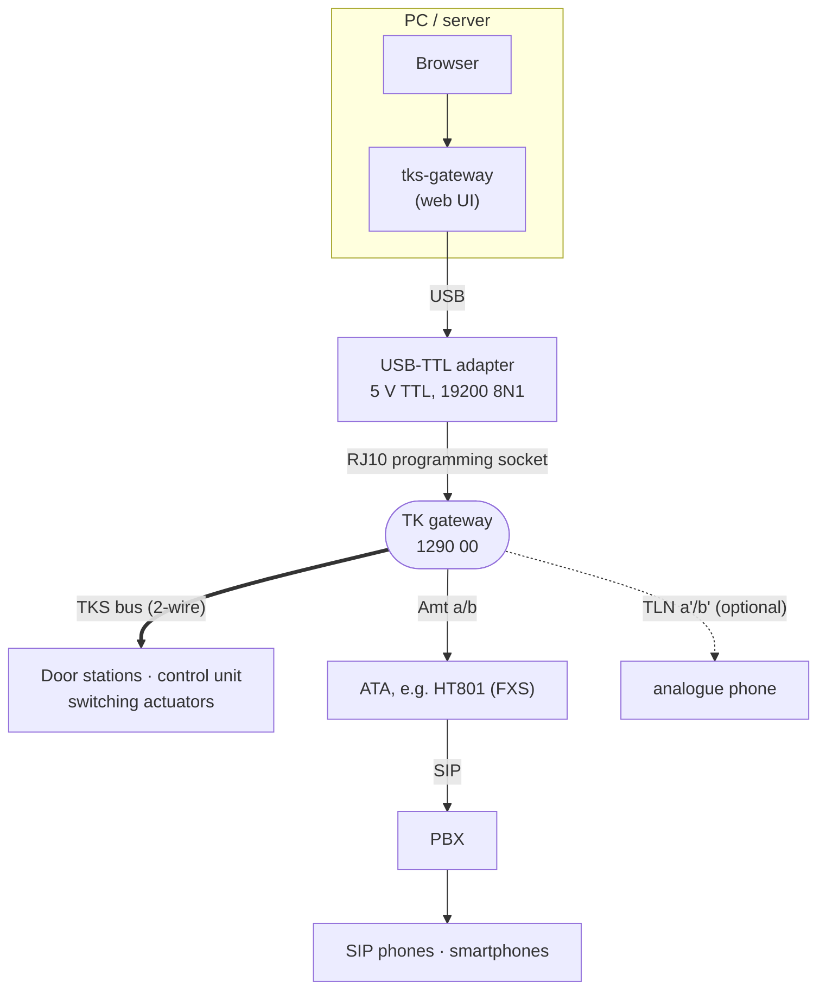
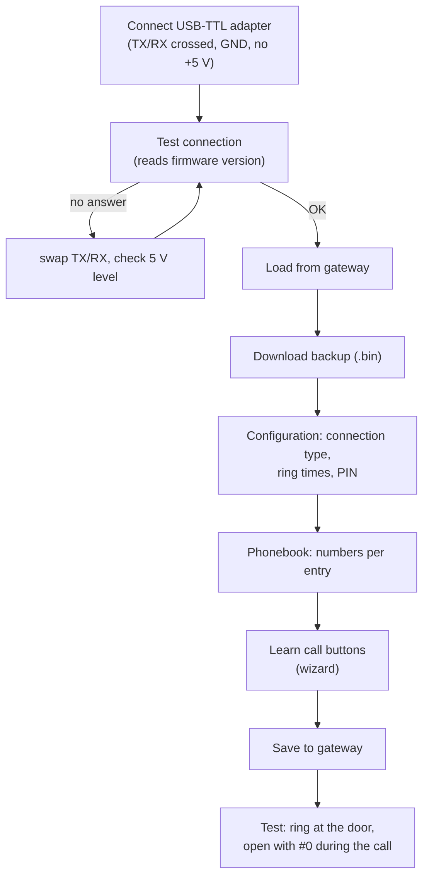
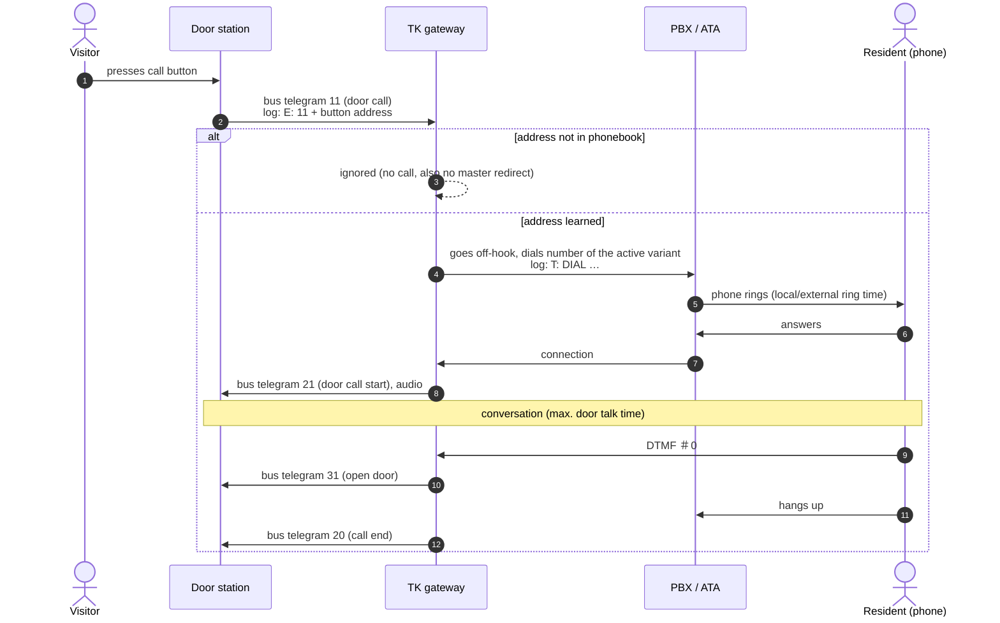
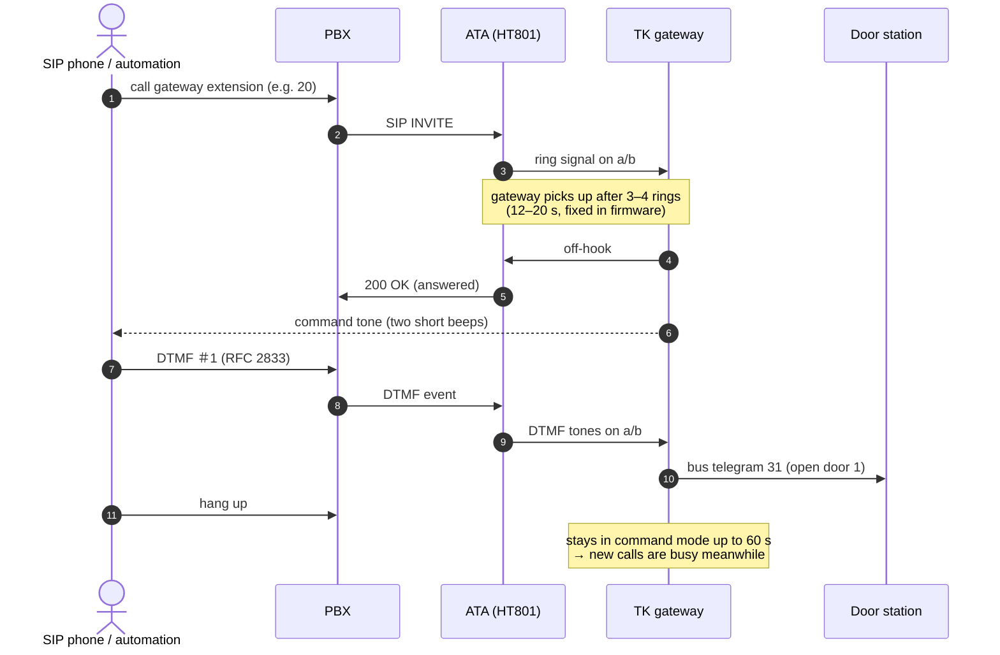
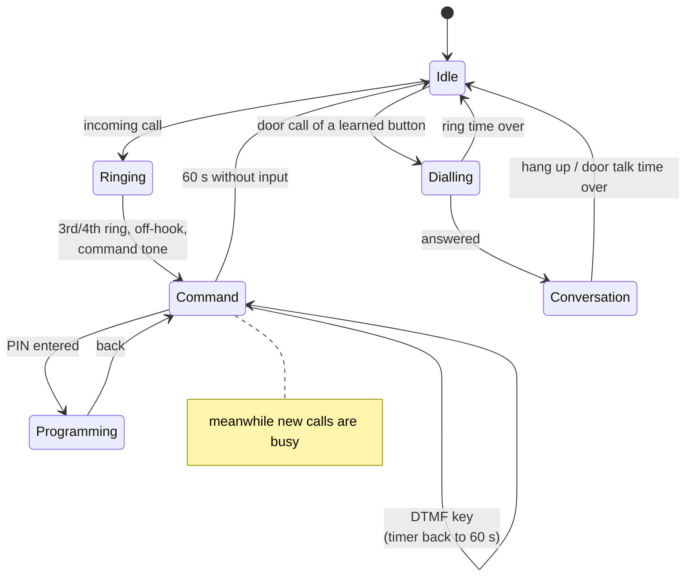
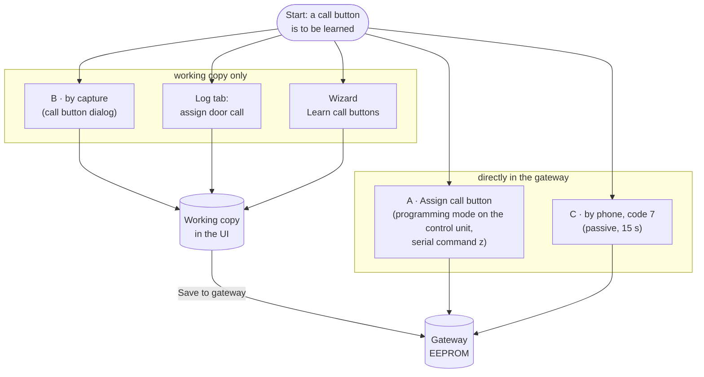
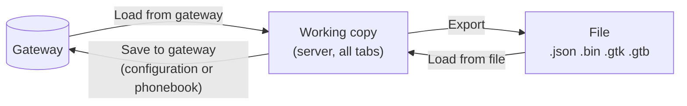

# User guide

How the Gira TK gateway 1290 00 works together with the door communication
system (TKS), a PBX and this software – from wiring to troubleshooting. The
**Help** tab of the web UI covers only the operation of the tool; see the
[UI reference](UI.md) for every tab, dialog and button.

Related documents: [UI reference](UI.md) · [Software architecture](ARCHITECTURE.md) ·
[Protocol and firmware findings](PROTOCOL.md) · [Hardware overview](HARDWARE.md) · [README](../README.md)

## Contents

1. [System overview](#1-system-overview)
2. [Programming plug (RJ10) – pinout](#2-programming-plug-rj10--pinout)
3. [First setup](#3-first-setup)
4. [What happens on a door call](#4-what-happens-on-a-door-call)
5. [Open the door without a door call (SIP)](#5-open-the-door-without-a-door-call-sip)
6. [Command mode and busy tone](#6-command-mode-and-busy-tone)
7. [Learning call buttons](#7-learning-call-buttons)
8. [Working copy and saving](#8-working-copy-and-saving)
9. [Reading the log](#9-reading-the-log)
10. [Phone codes (DTMF)](#10-phone-codes-dtmf)
11. [Troubleshooting](#11-troubleshooting)

## 1. System overview

The TK gateway connects the 2-wire bus of the Gira door communication system
(TKS) to an analogue telephone line. On a PBX it is an ordinary analogue
extension – for SIP systems typically via an analogue telephone adapter (ATA)
such as a Grandstream HT801. This software talks to the gateway through the
programming socket (serial, 19200 baud, TTL level).



| Gateway terminal | Function |
|---|---|
| `Ub` | supply 12–24 V DC or 12 V AC |
| `Amt a/b` | analogue telephone line or analogue extension port of a PBX / ATA |
| `TLN a'/b'` | analogue tone-dialling phone (direct line operation, DTMF programming) – leave free on a PBX |
| `BUS` | 2-wire TKS bus |

The programming connection is only needed for configuration. In normal
operation the gateway works on its own.

## 2. Programming plug (RJ10) – pinout

The programming socket is an RJ10 (4P4C) jack with **TTL level (5 V)**. The
original cable 1291 00 contains a MAX232 level converter; a USB-TTL adapter
(e.g. FTDI FT232R, Waveshare, CH340, PL2303) can be connected directly instead.

| Pin | Signal | Direction | USB-TTL adapter |
|---|---|---|---|
| 1 | GND | – | GND |
| 2 | +5 V | gateway → cable (powers the original converter) | **do not connect** |
| 3 | TxD of the gateway (RxD from the PC's view) | gateway → PC | RXD |
| 4 | RxD of the gateway (TxD from the PC's view) | PC → gateway | TXD |

```
RJ10 on the gateway              USB-TTL adapter (5 V)
 1 · GND  ───────────────────────  GND
 2 · +5 V ┄┄┄┄┄┄┄┄┄ ✕              VCC   (do not connect)
 3 · TxD  ──────────────────────▶  RXD
 4 · RxD  ◀──────────────────────  TXD
```

* Interface: 19200 baud, 8 data bits, no parity, 1 stop bit, no handshake.
* Set the adapter to **5 V** I/O (Waveshare: VCCIO jumper/switch). Never use
  the RS232 or RS485 output – ±12 V can destroy the gateway's controller.
* No answer to "Test connection": swap TX and RX – some modules are labelled
  the wrong way round.

**Determine the pin order by measuring.** The counting direction of the
contacts is not documented. The gateway supplies +5 V itself (gateway powered
via `Ub`, look at plug or socket from the front):

1. The two contacts with about **5 V** DC between them are GND (pin 1) and +5 V (pin 2).
2. The gateway's transmit output (pin 3) also sits at about 5 V against GND when idle (UART idle level high).
3. The remaining contact is pin 4 (input of the gateway).

Source: KNX-User-Forum, thread 8264 (2020); confirmed by several users with
USB-TTL adapters, not confirmed by Gira. More background in
[PROTOCOL.md](PROTOCOL.md#programming-interface-programming-set-1291-00).

## 3. First setup



* **Connection type:** "PBX extension" whenever the gateway hangs on a PBX or
  ATA – the wizard *Connect to PBX* in the configuration tab guides through it
  (see [UI reference](UI.md#wizard-connect-to-pbx)).
* **Ring times:** how long the gateway lets a phone ring before giving up
  (max. 120 s). The **door talk time** limits the conversation (max. 120 s).
* **Variant 1/2:** two numbers per entry, e.g. day/night, switchable by phone.
* **PIN:** protects programming by phone. Change the factory PIN `0000` when
  the gateway is on a PBX – every internal phone can call it.

## 4. What happens on a door call



Call buttons must **always** be learned. Unknown buttons are ignored by the
firmware, even with an active master redirect.

## 5. Open the door without a door call (SIP)

The door can be opened at any time without a preceding door call: call the
gateway, wait for the command tone and send `#` + the number of the door
station. No PIN is required. The programming interface cannot do this – there
is no serial command for it.



| Code | Effect |
|---|---|
| `#1` … `#9` | open door station 1…9 (numbers are shared with switching actuators, e.g. light) |
| `#0` | door that rang last (up to 2 min after the door call / 30 s after the conversation), otherwise the main door |

**Requirements on the SIP side**

* **DTMF must arrive as tones:** DTMF mode RFC 2833/RFC 4733 on PBX and ATA,
  codec G.711 (PCMA/PCMU). In-band DTMF over compressing codecs often fails.
* **Tone length** 150–250 ms per digit; some softphones send very short tones.
* **Ring timeout of the PBX ≥ 25 s**, no voicemail or group timeout before the
  gateway answers.
* To open twice in a row stay in the same call and send `#1` again – every key
  restarts the 60 s.

**Automation example (Asterisk)**

```
[door-opener]
exten => s,1,Wait(2)                 ; wait for the command tone
 same => n,SendDTMF(#1,250)          ; # + door station 1, 250 ms per tone
 same => n,Wait(2)
 same => n,Hangup()

; trigger: channel originate PJSIP/20 extension s@door-opener
```

> **Security:** anyone who can reach the gateway's extension can open the
> door – there is no PIN for this. Make sure no external number is routed to
> this extension and, if possible, only selected internal extensions may call
> it. The PIN only protects programming.

## 6. Command mode and busy tone

When the gateway answers a call it enters command mode. Every DTMF key
restarts a 60 s timer. No detection of "caller hung up" was found in the
firmware, so the gateway only hangs up after 60 s without input – calls during
that time are **busy**.



Command mode, incoming calls and DTMF input are **not** written to the log –
the firmware only logs bus telegrams and its own dialling. Details:
[PROTOCOL.md](PROTOCOL.md#configuration-0x0000x0ff) (command mode time limit).

## 7. Learning call buttons

Each phonebook entry needs the bus address of "its" call button. There are
four ways; they differ in whether the gateway stores the result itself or only
the working copy of this software changes.



| Way | How | Stored |
|---|---|---|
| A · control unit | "Systemprogr." 3 s on the control unit, press the call button 3 s, then "Fetch call button" per entry (serial command `z`) | by the gateway itself |
| B · capture | logging runs, the next door call is taken over | working copy – needs "Save to gateway" |
| Log tab | click "Assign" next to a door call `E: 11` | working copy – needs "Save to gateway" |
| Wizard | captures any number of call buttons, assigns them in a table, saves once at the end | written in the wizard's last step |
| C · by phone | `R * 0 * PIN #` then `* 7 * door station * entry #`, ring within 15 s (undocumented) | by the gateway itself |

* **Passive methods (B, log, wizard)** only listen to the bus: no programming
  mode, the gateway sends nothing. Every door call during the capture is
  detected – it really rings.
* Assignments from the passive methods take effect only after
  **Save to gateway**. An orange notice in the Log and Phonebook tabs shows how
  many are still pending (see [UI reference](UI.md#unsaved-call-buttons)).
* Holding a call button 3 s longer after the acknowledgement tone in
  programming mode deletes *all* assignments of that door station.

## 8. Working copy and saving



* Like the original, saving first reads the current image and then replaces
  only the edited part (configuration *or* phonebook). Unsaved changes of the
  other part stay in the working copy.
* The gateway only accepts complete images – an aborted transfer changes nothing.
* Make a backup (.bin) before the first write.

| Format | Content |
|---|---|
| `.json` | complete image, readable (configuration and phonebook) |
| `.bin` | raw 6144-byte image as stored in the gateway |
| `.gtk` | configuration in the format of the original software |
| `.gtb` | phonebook in the format of the original software |

## 9. Reading the log

| Line | Meaning |
|---|---|
| `E: 11 …` | door call received – contains the button address; can be assigned directly |
| `E: 21 / 20` | door call accepted / call end |
| `S: 31 …` | gateway opens the door |
| `S: 90 …` | bus driver query (sent by "Test output" / reading the version) |
| `S: 05 …` | request call button for an entry (method A) |
| `T: DIAL …` | gateway dials a number |

Without a bus connection the log stays empty except `S: 90` after "Test
output". The full list of telegram codes is in
[PROTOCOL.md](PROTOCOL.md#bus-log).

If the PC or container restarts while logging, the gateway keeps logging (the
flag lives in its RAM). The software switches the log off automatically when
it next connects and notes this in the log.

## 10. Phone codes (DTMF)

Entered on a tone-dialling phone at the TLN terminals (prefix `R` =
recall/flash key) or, with a PBX, after calling the gateway (without `R`). The
**Phone codes** tab of the UI shows the same table.

| Action | Code | Note |
|---|---|---|
| Unlock programming | `R * 0 * PIN #` | the codes with `*` follow (same call) |
| Enter phone number | `* 1 * index * no. V1 * no. V2 * AM #` | index 01–50, AM 0–3 |
| Assign call button (control unit) | `* 2 * door station * index #` | control unit in programming mode, waits 3 s |
| Assign call button (passive) – **undocumented** | `* 7 * door station * index #` | ring at the door within 15 s |
| Connection type | `* 3 * K #` | 0 = direct line, 1 = PBX extension |
| Local ring time | `* 4 * ZZZ #` | three digits in seconds, e.g. 030 |
| External ring time | `* 5 * ZZZ #` | three digits in seconds |
| Door talk time | `* 6 * ZZZ #` | three digits in seconds |
| Listen in – **undocumented** | `* 8 * K #` | 0 = off, 1 = on (no effect in firmware 1.26) |
| Change PIN | `* 9 * new PIN * new PIN #` | four digits |
| Master redirect number | `R * 1 * number #` | without PIN; an empty number deletes it |
| Master redirect number with AM – **undocumented** | `R * 1 * number * 1 #` | additionally sets the answering machine flag |
| Master redirect | `R * 2 * K #` | 0 = off, 1 = delayed, 2 = immediate |
| Switch variant | `R * 3 * K #` | 1 = day, 2 = night |
| Execute switching actuator | `R # number` | assignment: programming mode at control unit and actuator |
| Open door (during/after door conversation) | `# 0` | opens the door that rang; after 2 min (or 30 s after the conversation) the main door |
| Open door without conversation | `R # door station` | direct line: pick up, R key. PBX: call the gateway, then `#` + number of the door station (1–9) |
| Factory reset | `R * 9 * 1928374655 #` | deletes configuration AND phonebook completely; back up first |

Firmware details: [PROTOCOL.md](PROTOCOL.md#firmware-dtmf-programming-by-telephone).

## 11. Troubleshooting

| Symptom | Cause / remedy |
|---|---|
| no answer to "Test connection" | swap TX/RX; adapter on 5 V TTL (not RS232); check port and permissions (group `dialout`, SELinux – see [README](../README.md#container-podmandocker-compose)) |
| "no bus driver installed" although it is | gateway was still logging from a previous session – current versions switch this off automatically; otherwise power-cycle the gateway |
| gateway does not call on a door call | call button not learned or not saved; gateway not on the bus; check `E: 11` in the log |
| calling the gateway gives busy | still in command mode from the last call – wait 60 s |
| gateway answers late / not at all | it picks up on ring 3–4 (12–20 s); raise the PBX ring timeout to ≥ 25 s |
| door does not open via SIP | DTMF mode RFC 2833 + G.711, longer tones, correct door number |
| assignments are gone after reload | they were not written – use "Save to gateway" |
